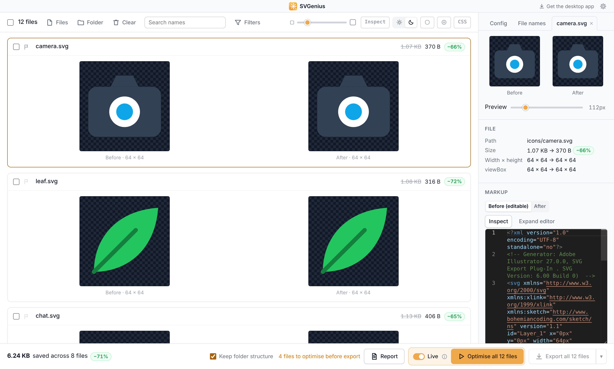

# SVGenius

**Tidy up a whole folder of SVGs in one go.** Drop in your icons, pick your rules once, and SVGenius squeezes every file down with [SVGO](https://github.com/svg/svgo), trims the empty space around the artwork and hands them back ready to ship. Usually 60–80% smaller, and the same rules apply to every file.

**[Open SVGenius in your browser →](https://marknotton.github.io/svgenius/)** · [Download the desktop app](https://github.com/marknotton/svgenius/releases/latest)


## What it does

- **Bulk optimise.** Add files or whole folders (sub-folders included) and optimise them all at once. Live mode re-runs as you change settings, so you see the result straight away.
- **Before and after, side by side.** Big previews on a light or dark checkerboard, with a circle guide for avatar-style crops.
- **Trim whitespace.** The viewBox hugs the artwork exactly, curves and round caps included, with optional padding.
- **Presets.** Save your favourite SVGO settings as named presets, give odd files their own, and import or export them as JSON to share with the team.
- **Find, filter and flag.** Filter by colour, element, attribute, markup text, file name or status. Flag files in colours and do things like "optimise everything except the red ones".
- **Edit the markup.** A proper code editor with an Inspect picker: click part of the artwork and jump to its markup.
- **Rules and recipes.** Find and replace, attribute rules, added markup, scale and nudge, plus custom SVGO plugins.
- **A plain-English report.** Copy a summary of what changed for a pull request or a client.




## Browser or desktop?

Both run the same app. Nothing is uploaded either way: SVGO runs on your own machine.

| | Browser | Desktop app |
|---|---|---|
| Install | Nothing, or "Install app" from the address bar | Download from [Releases](https://github.com/marknotton/svgenius/releases/latest) |
| After a refresh | Your files, edits and flags come back | Reopen the files |
| Export | One file downloads, more come as a zip | Writes straight into a folder you pick, keeping the folder structure |
| Settings and presets | Saved in the browser | Saved in the app's settings file |
| Works offline | Yes, after the first visit | Yes |

There is no file limit in either. The desktop app is handier for big batches because it writes straight back into folders.

> The desktop app isn't signed yet. On a Mac, right-click it and choose **Open** the first time.

## For developers

Tauri v2 (Rust) + React 19 + TypeScript, built with Vite and Yarn 4. SVGO runs in a pool of Web Workers (`svgo/browser`). Rust only handles file IO on the desktop: scanning folders, reading SVGs, writing exports and the settings file. `src/lib/platform.ts` swaps those for browser equivalents (file pickers, drag and drop, zip downloads, `localStorage`) when the app runs on the web.

Custom plugin code is imported from a blob URL inside the workers only (hence `script-src blob:` in the CSP), so it never touches the window or Tauri's IPC.

| Command | What it does |
|---|---|
| `yarn install` | Install dependencies |
| `yarn tauri:dev` | Run the desktop app with hot reload (Vite on :1420) |
| `yarn dev` | Run the browser version at http://localhost:1420 |
| `yarn tauri:build` | Build the `.app` / `.dmg` into `src-tauri/target/release/bundle/` |
| `yarn build:web` | Build the browser version for GitHub Pages into `dist/` |
| `cargo test --manifest-path src-tauri/Cargo.toml` | Rust unit tests |

**Publishing.** Every push to `main` builds the browser version and publishes it to GitHub Pages (`.github/workflows/pages.yml`). To make a desktop release, run the **Desktop release** workflow from the Actions tab (or push a tag like `v0.2.0`). It builds macOS and Windows installers into a draft release that you publish when happy.

```
src/
  App.tsx                 wiring: files, presets, export
  components/             UI pieces (FileList, ConfigPanel, FileInspector, …)
  hooks/useAppSettings.ts persisted settings + preset actions
  hooks/useItems.ts       file list and optimisation queue
  lib/platform.ts         desktop (Tauri) or browser: files, dialogs, settings
  lib/plugins.ts          SVGO plugin catalogue (labels, defaults, order)
  lib/settings.ts         defaults, validation, SVGO config, import/export
  lib/optimiser*.ts       Web Worker pool running SVGO
public/                   web app manifest, service worker, icons
src-tauri/src/lib.rs      file IO commands
```
