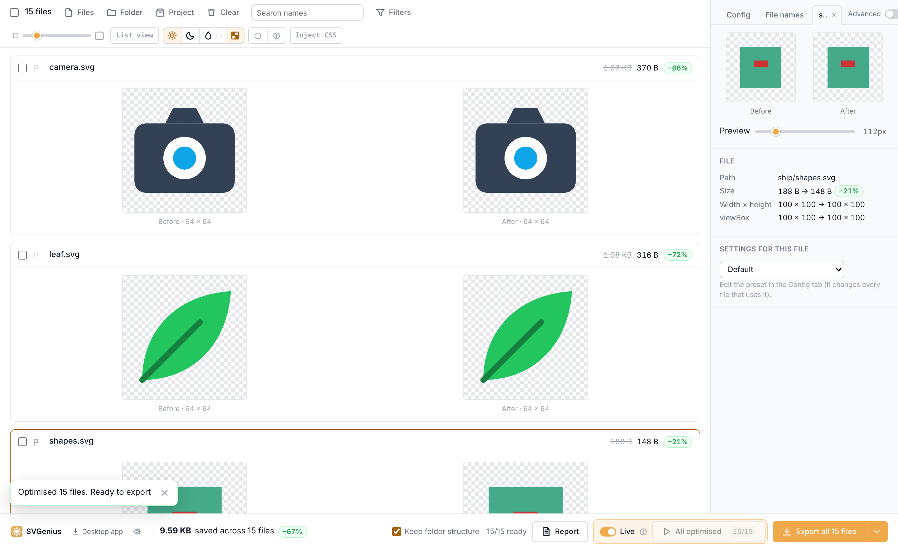
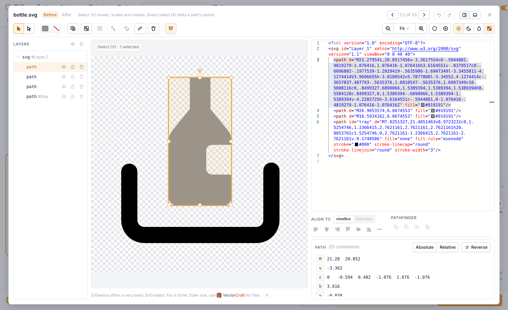
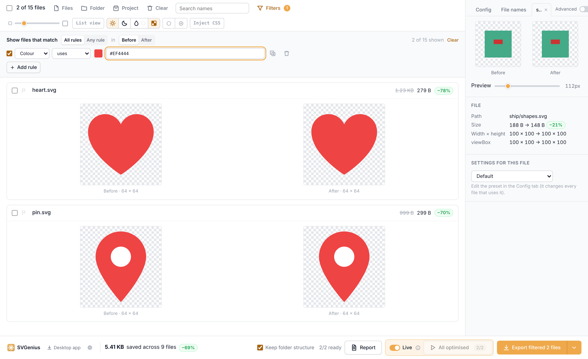
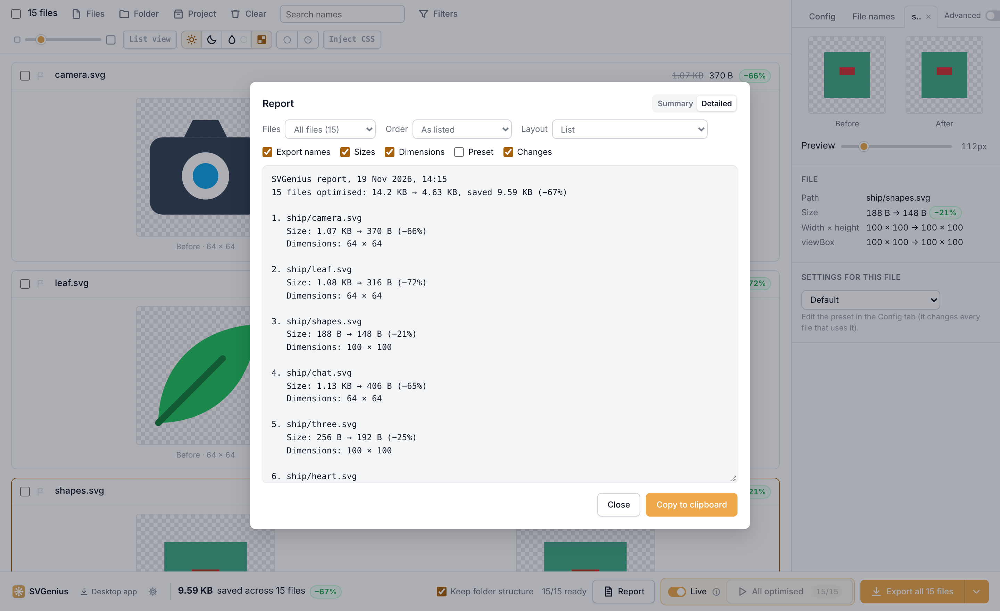

# SVGenius

**Tidy up a whole folder of SVGs in one go.** Drop in your icons, pick your rules once, and SVGenius squeezes every file down with [SVGO](https://github.com/svg/svgo), trims the empty space around the artwork and hands them back ready to ship. Usually 60–80% smaller, and the same rules apply to every file.

**[Open SVGenius in your browser →](https://marknotton.github.io/svgenius/)** · [Download the desktop app](https://github.com/marknotton/svgenius/releases/latest)



## What it does

- **Bulk optimise.** Add files or whole folders (sub-folders included) and optimise them all at once. Live mode re-runs as you change settings, so you see the result straight away.
- **Before and after.** A compact list or big side-by-side previews, on light, dark or custom backgrounds, with a circle guide and clip for avatar-style crops.
- **Trim whitespace.** The viewBox hugs the artwork exactly, curves and round caps included, with optional padding.
- **Presets.** Save your favourite SVGO settings as named presets, give odd files their own, and import or export them as JSON to share with the team.
- **Find, filter and flag.** Filter by colour, element, attribute, markup text, file name or status. Flag files in colours and do things like "optimise everything except the red ones".
- **A small SVG editor.** Double-click a file to open it. Select and direct-select tools, a layers panel (show, hide, lock, reorder), fill and stroke, align, pathfinder, snapping guides, copy and paste in place, zoom, and a code editor that stays in sync. Hold C to peek at the optimised result.
- **Rules and recipes.** Find and replace, attribute rules, added markup, scale and nudge, renaming patterns, plus custom SVGO plugins.
- **Projects.** Save the whole session (files, edits, flags, settings) as a `.svgenius` file and open it later.
- **Export your way.** Everything at once, the filtered set, or a single file from its right-click menu.
- **A plain-English report.** Copy a summary of what changed for a pull request or a client.








## Install the desktop app

1. Go to [Releases](https://github.com/marknotton/svgenius/releases/latest).
2. **Mac:** download `SVGenius_x.y.z_universal.dmg`, open it and drag SVGenius into Applications. It runs natively on Apple silicon and Intel.
   **Windows:** download the `.msi` (or the `-setup.exe`) and run it.
3. **First launch on a Mac.** The app isn't signed with an Apple Developer certificate yet, so macOS will say it can't verify it. Either:
   - open **System Settings → Privacy & Security**, scroll down and click **Open Anyway** next to SVGenius, or
   - run `xattr -dr com.apple.quarantine /Applications/SVGenius.app` in Terminal once.

   After that it opens like any other app. If macOS says the app "is damaged", it's the same quarantine flag: the `xattr` command fixes it.

## Browser or desktop?

Both run the same app. Nothing is uploaded either way: SVGO runs on your own machine.

| | Browser | Desktop app |
|---|---|---|
| Install | Nothing, or "Install app" from the address bar | Download from [Releases](https://github.com/marknotton/svgenius/releases/latest) |
| After a refresh | Your files, edits and flags come back | Reopen the files, or a saved project |
| Export | One file downloads, more come as a zip | Writes straight into a folder you pick, keeping the folder structure |
| Open SVGs from Finder | No | Yes, plus `.svgenius` projects |
| Settings and presets | Saved in the browser | Saved in the app's settings file |
| Works offline | Yes, after the first visit | Yes |

There is no file limit in either. The desktop app is handier for big batches because it writes straight back into folders.

## Credits

Built by [Mark Notton](https://github.com/marknotton). SVGenius stands on these open-source projects:

| Project | Licence | Used for |
|---|---|---|
| [SVGO](https://github.com/svg/svgo) | MIT | The optimiser at the heart of the app. Every plugin in the settings is SVGO's |
| [Paper.js](http://paperjs.org) | MIT | Vector geometry: trim bounds, flattening transforms, pathfinder |
| [Monaco Editor](https://microsoft.github.io/monaco-editor/) | MIT | The code editor |
| [React](https://react.dev) | MIT | The user interface |
| [Tauri](https://tauri.app) | MIT / Apache-2.0 | The desktop app shell, with Rust for file access |
| [fflate](https://github.com/101arrowz/fflate) | MIT | Zipping exports in the browser |
| [CSSTree and CSSO](https://github.com/csstree/csstree) | MIT | Parsing and minifying CSS inside SVGs, via SVGO |
| [Vite](https://vite.dev), [TypeScript](https://www.typescriptlang.org), [Playwright](https://playwright.dev) | MIT / Apache-2.0 | Building, type-checking and testing |

**Inspired by** (ideas only, no code borrowed): [SVG Path Editor](https://github.com/Yqnn/svg-path-editor) by Yqnn, [Inkscape](https://inkscape.org)'s XML editor and layers, browser developer tools' element picker, and [SVGOMG](https://github.com/jakearchibald/svgomg) by Jake Archibald. For proper drawing and richer vector work, [VectorCraft](https://getartcraft.com/apps/vectorcraft) is a free, fuller editor (not affiliated).

## For developers

Tauri v2 (Rust) + React 19 + TypeScript, built with Vite and Yarn 4. SVGO runs in a pool of Web Workers (`svgo/browser`). Rust only handles file IO on the desktop: scanning folders, reading SVGs, writing exports and the settings file. `src/lib/platform.ts` swaps those for browser equivalents (file pickers, drag and drop, zip downloads, `localStorage`) when the app runs on the web.

Custom plugin code is imported from a blob URL inside the workers only (hence `script-src blob:` in the CSP), so it never touches the window or Tauri's IPC.

| Command | What it does |
|---|---|
| `yarn install` | Install dependencies |
| `yarn tauri:dev` | Run the desktop app with hot reload (Vite on :1420) |
| `yarn dev` | Run the browser version at http://localhost:1420 |
| `yarn tauri:build` | Build the `.app` / `.dmg` into `src-tauri/target/release/bundle/` |
| `yarn build:web` | Build the browser version for GitHub Pages into `dist/` |
| `cargo test --manifest-path src-tauri/Cargo.toml` | Rust unit tests |

**Publishing.** Every push to `main` builds the browser version and publishes it to GitHub Pages (`.github/workflows/pages.yml`). To make a desktop release, run the **Desktop release** workflow from the Actions tab (or push a tag like `v1.0.0`). It builds macOS and Windows installers into a draft release that you publish when happy.

```
src/
  App.tsx                 wiring: files, presets, export
  components/             UI pieces (FileList, ConfigPanel, FileInspector, …)
  hooks/useAppSettings.ts persisted settings + preset actions
  hooks/useItems.ts       file list and optimisation queue
  lib/platform.ts         desktop (Tauri) or browser: files, dialogs, settings
  lib/plugins.ts          SVGO plugin catalogue (labels, defaults, order)
  lib/settings.ts         defaults, validation, SVGO config, import/export
  lib/optimiser*.ts       Web Worker pool running SVGO
  lib/project.ts          .svgenius project files
  components/MarkupDialog.tsx  the editor
public/                   web app manifest, service worker, icons
src-tauri/src/lib.rs      file IO commands
```
